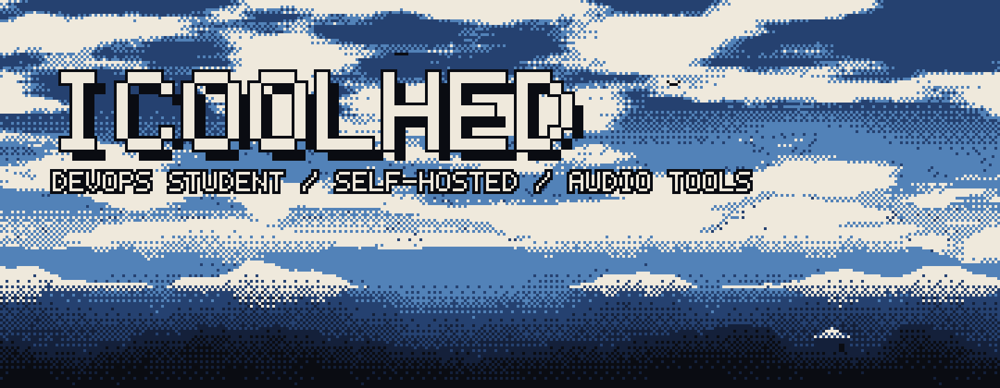
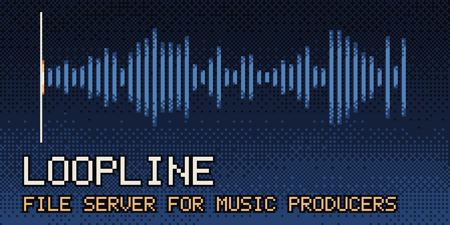
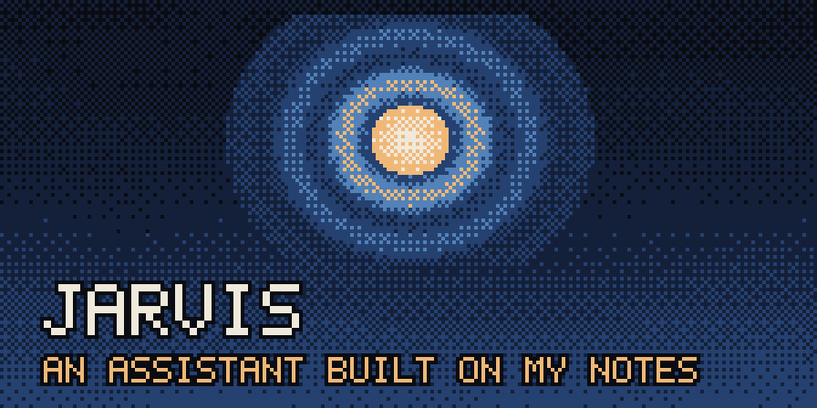
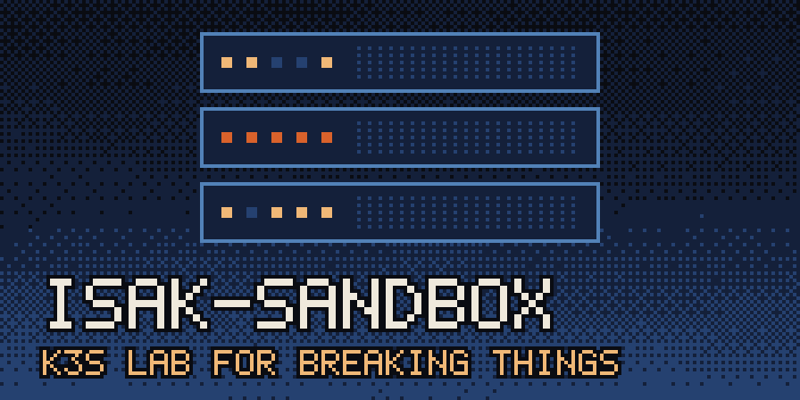
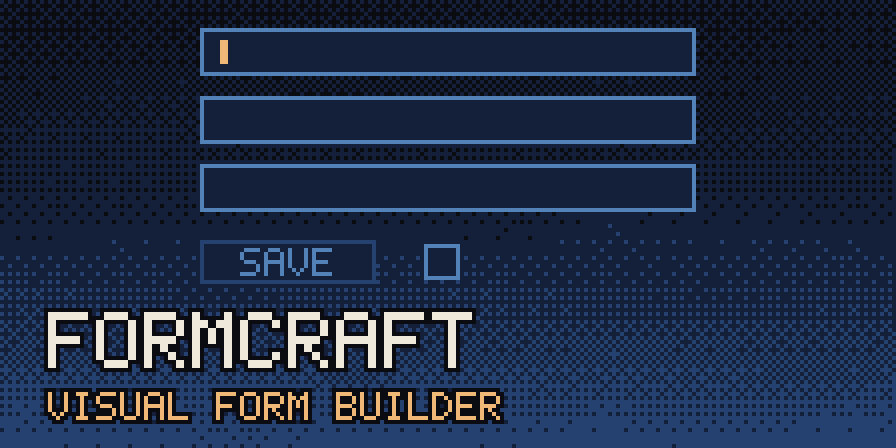

<!--
  The images are drawn by .github/profile/render.py and published to the
  `output` branch by .github/workflows/profile.yml, hourly and on every change.
-->

 

  <b>Isak.</b> DevOps student in Sweden. 
  I run my own servers, break them on purpose in a K3s sandbox, 
  and build tools around making music.

  <code>NOW</code>&nbsp; building Loopline &nbsp;·&nbsp; learning Linux, Bash, K3s and CI/CD

 

  
  

  
  

  
  

 

How this page is drawn

 
Every image comes from <a href="https://github.com/Icoolhed/Icoolhed/tree/main/.github/profile">a small Python script</a> in this repo: ordered dithering in eight colours, no dependencies, redrawn every hour. The sky follows Stockholm: the sun's height, the moon's phase, cloud, rain and snow, and northern lights on the rare nights the Kp index reaches 5. Rain, snow and the chimney smoke lean with the wind. The cabin window is lit if I pushed something today or yesterday, every star is a contribution from the last 12 months, and each contribution today is a shooting star tonight.

