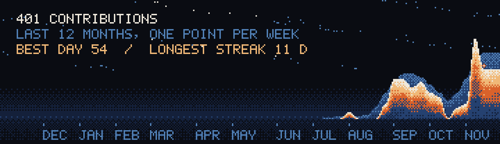

<!--
  The two images are drawn by .github/profile/render.py and published to the
  `output` branch by .github/workflows/profile.yml, daily and on every change.
-->

I'm Isak, a DevOps student in Sweden. I run my own servers, break them on purpose in a K3s sandbox, and build tools around making music.

Right now I'm building Loopline and learning Linux, Bash, K3s and CI/CD pipelines.

### Projects

- **Loopline**: a self-hosted file server built around a producer's workflow. Tagged folders, BPM and key detection from filenames, waveform previews in the browser, a playback queue and password-protected share links. FastAPI, Docker, SQLite.
- **Artspecifikationer**: a field guide in Swedish where every animal gets a technical data sheet instead of an encyclopedia entry. React, Vite.
- **isak-sandbox**: a single-node K3s box, provisioned with Ansible and managed by ArgoCD. Home-lab ideas get tried here first.
- **[Formcraft](https://github.com/icoolhed-hq/formcraft)**: a visual form builder in one React file that exports schema JSON or a React and Tailwind component.

### Last 12 months

Both images are generated by <a href=".github/profile">a small Python script</a> in this repo: ordered dithering in eight colours, no dependencies. They are redrawn every hour from what is actually happening in Stockholm: the sun's height, the moon's phase, cloud, rain and snow, and northern lights on the rare nights the Kp index reaches 5. The cabin window is lit if I pushed something today or yesterday, and each contribution today is a shooting star tonight.
